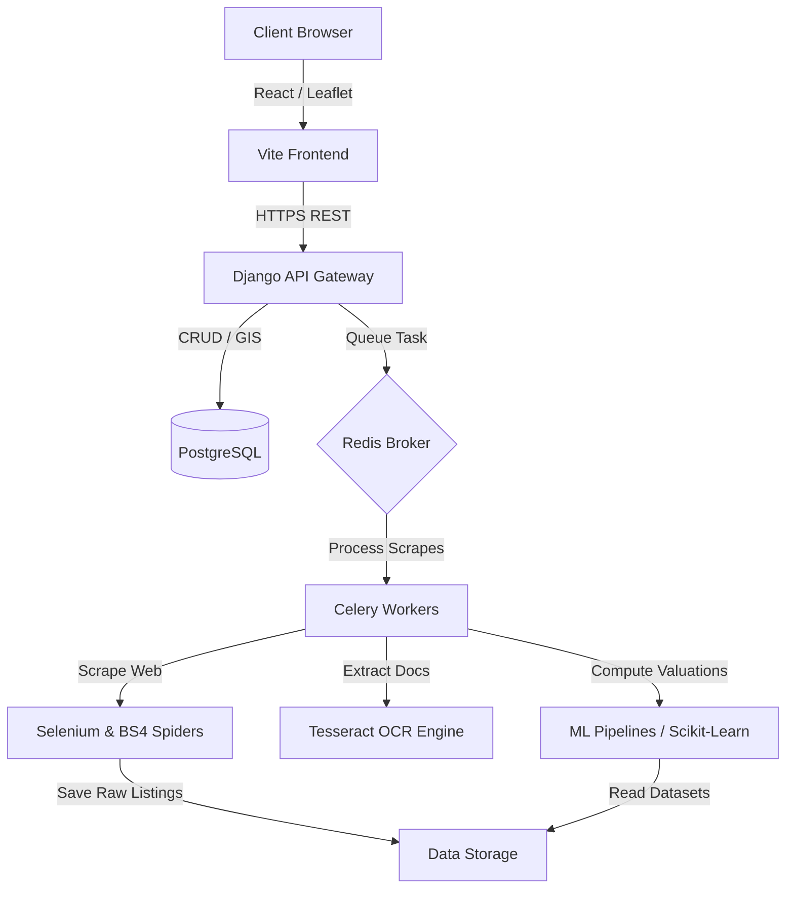

# Verixa – Intelligent Property Decision & Verification Platform

Verixa is a production-ready startup platform designed to help property buyers and real estate investors research, verify, compare, and evaluate properties with confidence. By combining automated web scraping, optical character recognition (OCR) of legal documents, automated geospatial maps, and machine learning scoring, Verixa delivers data-driven verification of property boundaries, ownership histories, zoning restrictions, and valuation forecasts.

## 🚀 Technology Stack
*   **Frontend**: React, Vite, Tailwind CSS, Leaflet, OpenStreetMap
*   **Backend**: Django, Django REST Framework (DRF), Celery, Redis
*   **Database**: PostgreSQL
*   **Machine Learning**: Scikit-learn, Pandas, NumPy
*   **Data Collection**: Selenium, BeautifulSoup4
*   **OCR & Document Parsing**: Tesseract OCR, PyTesseract

---

## 🏛️ System Architecture

Verixa is designed as a decoupled, service-oriented monorepo. It features a fast React SPA, a robust REST API backend, standalone machine learning services for batch valuation/decision predictions, and specialized scraping spiders to collect raw real estate records asynchronously.



---

## 📂 Project Directory Structure

```
verixa/
├── .github/                      # CI/CD Workflows & GitHub Configuration templates
│   ├── workflows/                # Lint & Test runners for services
│   └── PULL_REQUEST_TEMPLATE.md  # Standard PR template
├── assets/                       # Static media assets and brand design resources
├── backend/                      # Django + DRF API service
│   ├── apps/                     # Decoupled Django apps for business features
│   ├── common/                   # Core/Shared Django classes (middleware, helpers)
│   └── verixa_core/              # Main configuration and settings module
├── datasets/                     # Raw, processed, and external geospatial data
├── docs/                         # Extensive developer documentation and specifications
├── frontend/                     # React + Vite + Tailwind SPA
│   ├── public/                   # Public assets
│   └── src/                      # React source code (components, hooks, pages)
├── ml/                           # Scikit-learn prediction model pipelines
├── scrapers/                     # BeautifulSoup and Selenium scraping framework
├── scripts/                      # DB seeding & environment bootstrapping scripts
├── tests/                        # Integration and end-to-end test cases
├── docker-compose.yml            # Local development orchestration setup
├── LICENSE                       # MIT License
└── README.md                     # This README
```

---

## ⚙️ Getting Started

### Prerequisites
Make sure you have the following installed on your system:
*   [Docker & Docker Compose](https://www.docker.com/)
*   [Node.js](https://nodejs.org/) (v18+ recommended)
*   [Python](https://www.python.org/) (v3.10+ recommended)
*   [Tesseract OCR Engine](https://github.com/tesseract-ocr/tesseract)

### Initial Setup
1.  Clone this repository to your workspace.
2.  Duplicate the environment template and configure your secrets:
    ```bash
    cp .env.example .env
    ```
3.  **Local Bootstrapping**:
    Run the setup script corresponding to your operating system to install local dev dependencies:
    *   **Windows**: Run `powershell -File scripts/setup.ps1`
    *   **Unix**: Run `bash scripts/setup.sh`

### Running the Services Locally (Docker)
To spin up all services (PostgreSQL, Redis, Django Backend, Celery, and React Frontend) concurrently with hot-reloading:
```bash
docker-compose up --build
```
The frontend will be active at `http://localhost:5173` and the Django API backend at `http://localhost:8000`.

### Running Services Separately
If you prefer to run services in separate terminals outside Docker:

#### 1. Backend (Django)
```bash
cd backend
python -m venv venv
# Activate virtual environment
source venv/bin/activate  # Unix
venv\Scripts\activate     # Windows
pip install -r requirements.txt
python manage.py migrate
python manage.py runserver
```

#### 2. Frontend (React)
```bash
cd frontend
npm install
npm run dev
```

#### 3. Scrapers & ML
See the documentation inside `scrapers/README.md` and `ml/README.md` for specific execution arguments.
