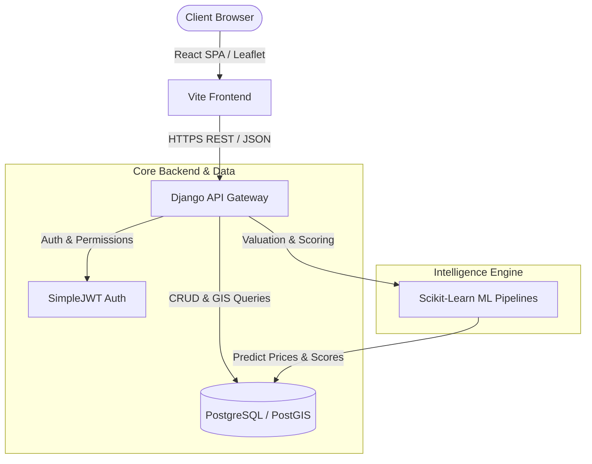

# 🏢 Verixa – Intelligent Property Decision & Analytics Platform

[](https://github.com/verixa/verixa)
[](https://github.com/verixa/verixa)
[](https://www.python.org/)
[](https://www.djangoproject.com/)
[](https://reactjs.org/)
[](https://scikit-learn.org/)
[](https://www.docker.com/)
[](LICENSE)

> **Verixa** is a full-stack Property Intelligence & Decision Platform that empowers real estate buyers, investors, and institutions to evaluate, compare, and value real estate assets with data-backed confidence.

---

## 📌 Executive Summary

Traditional real estate portals focus solely on basic listing discovery, leaving buyers without objective valuation, locality insights, or comparative tools.

**Verixa** solves this by unifying **Machine Learning fair price forecasting**, **Geospatial GIS locality tracking**, **Builder credibility scoring**, **Market trend analytics**, and **side-by-side comparative decision tools** into a seamless, high-performance web platform.

---

## ✨ Key Features & Capabilities

### 🏠 1. Smart Property Discovery & Search
- **Multi-Dimensional Search & Filtering**: Filter listings by price range, area, BHK configuration, furnishing status, facing direction, property age, locality score, and verified listing status.
- **Comprehensive Property Dossier**: Detailed property view featuring image carousels, legal record info (Survey & Khata numbers), floor plans, historical price timelines, and contact options.
- **Price History Tracking**: Track historical price changes for listings to identify market trends and price adjustments.

### 🤖 2. Machine Learning Valuation & Predictive Engine
- **Fair Price Predictor**: Scikit-Learn machine learning pipeline (Random Forest & Gradient Boosting algorithms) trained on real estate market data (`properties_property.csv`) to estimate fair market valuation based on area, BHK, location, age, and amenities.
- **Multi-Factor Scorecards**:
  - **Investment Score**: Dynamic rating evaluated against locality appreciation rate, connectivity, and fair valuation margin.
  - **Risk Score**: Risk index computed from builder history, document completeness, and pricing variance.
  - **Builder Score**: Track record evaluation based on past project completions, RERA registration, and delivery history.
  - **Locality & Connectivity Score**: GIS-calculated index based on access to transit, commercial hubs, and essential amenities.

### 🗺️ 3. GIS Spatial & Locality Intelligence
- **Interactive Map Suite**: Integrated Leaflet & OpenStreetMap interactive spatial maps with real-time property markers and radius search.
- **Nearby Places & Amenities**: View proximity metrics for essential amenities (Schools, Hospitals, Bus Stops, Metro Stations, Malls, and Parks).
- **Locality Scorecard**: Neighborhood analysis featuring safety ratings, infrastructure quality, green space ratio, and connectivity indices.

### ⚖️ 4. Side-by-Side Property Comparison Engine
- **Multi-Property Matrix**: Compare up to 4 properties simultaneously across 25+ parameters including Asking Price vs. ML Fair Price, Price/SqFt, Investment Rating, BHK, Locality, and Nearby Amenities.
- **Visual Difference Highlighting**: Instant visual indicators highlighting best value, lowest risk score, and highest connectivity.

### 📊 5. Market Trends & Analytics
- **Locality Appreciation Trends**: Historical & projected price per square foot trends across various micro-markets.
- **Inventory & Pricing Metrics**: Market volume metrics, average price/sqft, and demand indices.

### 📑 6. Automated Investment Report Generator
- **Downloadable Property Dossiers**: Generate comprehensive PDF and JSON property evaluation reports for buyers and investors.
- **Valuation Breakdown**: Includes fair price estimate, confidence interval, locality scorecard, and builder credibility breakdown.

### 💬 7. Inquiries & Lead Management Pipeline
- **Direct Messaging**: Connect buyers directly with property owners and verified builders.
- **Site Visit Requests**: Integrated scheduling system for requesting property visits.

### 🔐 8. Security & User Management
- **Role-Based Access Control (RBAC)**: Custom profiles for Buyers, Investors, Builders, and System Administrators.
- **Enterprise Authentication**: Secure JWT (JSON Web Tokens) authentication with refresh tokens, password hashing, and protected routes.

---

## 🏛️ System Architecture

Verixa is structured as a decoupled, service-oriented monorepo:



---

## 🛠️ Tech Stack

| Domain | Technology / Framework | Description |
| :--- | :--- | :--- |
| **Frontend Core** | React 18, Vite | High-performance single page application framework |
| **Styling & UI** | Tailwind CSS, Lucide Icons | Responsive, modern utility-first UI design system |
| **Mapping & GIS** | Leaflet, React-Leaflet, OpenStreetMap | Interactive spatial map visualization & property markers |
| **State & HTTP** | Axios, React Router v6 | Client-side routing and REST API client |
| **Backend API** | Django 4.2, Django REST Framework (DRF) | Production-grade Python web framework & REST API gateway |
| **Database** | PostgreSQL + PostGIS | Enterprise relational database with spatial GIS support |
| **Machine Learning**| Scikit-learn, Pandas, NumPy, Joblib | Machine learning model training, feature engineering & inference |
| **Containerization**| Docker, Docker Compose | Multi-container environment orchestration |

---

## 📂 Project Directory Structure

```
Verixa/
├── backend/                      # Django + DRF API Gateway
│   ├── apps/                     # Modular Django Applications
│   │   ├── accounts/             # User Auth, Profiles & JWT
│   │   ├── builders/             # Builder Profiles & Track Records
│   │   ├── comparison/           # Side-by-Side Comparison Engine & Sessions
│   │   ├── core/                 # Shared Base Models & Core Utilities
│   │   ├── inquiries/            # Buyer-Seller Inquiry Management
│   │   ├── locations/            # Localities, GIS Scorecards & Nearby Places
│   │   ├── properties/           # Property CRUD, Listings, Legal Records & Price History
│   │   └── reports/              # Investment PDF/JSON Report Generator
│   ├── common/                   # Global Middleware & Helpers
│   ├── verixa_core/              # Django Main Settings & URL Routing
│   ├── Dockerfile                # Backend Docker Configuration
│   ├── manage.py                 # Django CLI Tool
│   └── requirements.txt          # Backend Python Dependencies
├── frontend/                     # React 18 + Vite SPA Frontend
│   ├── public/                   # Static Public Assets
│   ├── src/                      # Source Code
│   │   ├── app/                  # Application Providers & Router Setup
│   │   ├── features/             # Feature Modules (Auth, Properties, Market, Comparison, etc.)
│   │   ├── shared/               # Reusable UI Components, Layouts & Utilities
│   │   ├── App.jsx               # Root Application Component
│   │   └── index.css             # Tailwind Design System & Custom CSS
│   ├── Dockerfile                # Frontend Production Dockerfile
│   ├── package.json              # Frontend Package Dependencies
│   └── vite.config.js            # Vite Build Tool Configuration
├── ml/                           # Scikit-Learn Machine Learning Pipeline
│   ├── config/                   # Hyperparameters & Model Configs
│   ├── models/                   # Serialized Trained Model Artifacts (.pkl)
│   ├── model_loader.py           # Model Loading & Caching Engine
│   ├── prediction_service.py     # Real-time Fair Price & Score Inference API
│   ├── preprocessing.py          # Data Preprocessing & Feature Encoding
│   ├── properties_property.csv   # Real Estate Training Dataset
│   ├── requirements.txt          # Machine Learning Dependencies
│   └── train.py                  # Model Training Execution Script
├── scripts/                      # Data Ingestion & Seeding Utility Scripts
│   ├── generate_amenities_csv.py # Amenity Data Script
│   ├── generate_legal_data_csv.py# Legal Record Generator
│   └── import_exact_csvs.py      # Master CSV Database Seeder Script
├── docker-compose.yml            # Multi-service Docker Orchestration Config
├── LICENSE                       # MIT Open Source License
├── MILESTONE.md                  # Milestone & Progress Documentation
├── PROJECT_CONTEXT.md            # Technical & Functional Specifications
└── README.md                     # Main Project Documentation (This File)
```

---

## ⚡ Getting Started

### Prerequisites

Ensure you have the following installed locally:
- [Docker](https://www.docker.com/) & [Docker Compose](https://docs.docker.com/compose/) (Recommended)
- [Node.js](https://nodejs.org/) (v18.0 or higher)
- [Python](https://www.python.org/) (v3.10 or higher)

---

### 🚀 Option 1: Quickstart with Docker Compose (Recommended)

To spin up all services (**PostgreSQL Database**, **Django Backend**, and **React Frontend**) in containers:

1. **Clone the repository**:
   ```bash
   git clone https://github.com/verixa/verixa.git
   cd verixa
   ```

2. **Configure Environment Variables**:
   ```bash
   cp .env.example .env
   ```

3. **Build and Launch Containers**:
   ```bash
   docker-compose up --build
   ```

4. **Access the Applications**:
   - **Frontend App**: `http://localhost:5173`
   - **Django API Backend**: `http://localhost:8000/api/v1/`
   - **Django Admin Portal**: `http://localhost:8000/admin/`

---

### 🛠️ Option 2: Manual Local Setup

#### 1. Database Setup (PostgreSQL)
Ensure PostgreSQL is running locally and create a database named `verixa_db`:
```sql
CREATE DATABASE verixa_db;
```

#### 2. Backend API Setup (Django)
```bash
cd backend
python -m venv venv

# Activate Virtual Environment
# On Windows:
venv\Scripts\activate
# On macOS/Linux:
source venv/bin/activate

# Install Dependencies
pip install -r requirements.txt

# Apply Migrations
python manage.py migrate

# Seed Initial Real Estate Dataset
python ../scripts/import_exact_csvs.py

# Create Superuser (Admin)
python manage.py createsuperuser

# Start Development Server
python manage.py runserver
```

#### 3. Machine Learning Model Training
To train the Fair Price Predictor and generate model artifacts:
```bash
cd ml
python train.py
```

#### 4. Frontend Setup (React + Vite)
```bash
cd frontend
npm install
npm run dev
```

---

## 📊 Machine Learning Model Pipeline

Verixa includes a machine learning engine for real estate valuation and scoring:

- **Preprocessing Pipeline** (`ml/preprocessing.py`): Performs numerical scaling (StandardScaler), categorical encoding, missing value handling, and feature engineering (price per sqft, property age category, locality density).
- **Training** (`ml/train.py`): Evaluates regression models (**Random Forest Regressor**, **Gradient Boosting Regressor**) using K-Fold Cross Validation. Selects the optimal model based on **Mean Absolute Error (MAE)** and **R² Score**.
- **Inference Service** (`ml/prediction_service.py`): Exposes real-time prediction endpoints for fair price valuation, confidence interval, and multi-factor investment scores.

---

## 🌐 API Endpoint Reference

Summary of key REST API endpoints provided by the Django backend (`/api/v1/`):

| Module | Endpoint | Method | Description | Auth |
| :--- | :--- | :--- | :--- | :--- |
| **Auth** | `/api/v1/auth/register/` | `POST` | User registration | Public |
| **Auth** | `/api/v1/auth/login/` | `POST` | User authentication & JWT token dispatch | Public |
| **Auth** | `/api/v1/auth/profile/` | `GET/PUT` | Retrieve / Update user profile | Bearer |
| **Properties** | `/api/v1/properties/` | `GET` | Paginated search, filter & sort properties | Public |
| **Properties** | `/api/v1/properties/{id}/` | `GET` | Comprehensive property detail view | Public |
| **Properties** | `/api/v1/properties/{id}/valuation/` | `GET` | ML Fair Price & Score inference | Public |
| **Localities** | `/api/v1/locations/localities/` | `GET` | List localities with locality scorecards | Public |
| **Localities** | `/api/v1/locations/nearby-places/` | `GET` | GIS proximity data & nearby amenity breakdown | Public |
| **Builders** | `/api/v1/builders/` | `GET` | List builders & track record stats | Public |
| **Comparison** | `/api/v1/comparison/` | `POST` | Create multi-property comparison session | Public |
| **Reports** | `/api/v1/reports/generate/` | `POST` | Generate PDF/JSON Property Evaluation Report | Bearer |
| **Inquiries** | `/api/v1/inquiries/` | `POST` | Submit inquiry / schedule site visit | Bearer |

---

## 🧪 Testing & Quality Assurance

### Backend Unit & Integration Tests
Run Django automated test suite:
```bash
cd backend
python manage.py test
```

### Machine Learning Validation
Run ML pipeline tests:
```bash
cd ml
python -m unittest discover -s . -p "test_*.py"
```

### Frontend Build Verification
Verify React frontend build:
```bash
cd frontend
npm run build
```

---

## 🛡️ License

This project is licensed under the MIT License - see the [LICENSE](LICENSE) file for details.

---

## 🤝 Acknowledgments & Authors

- **Verixa Development Team**: Developed as a capstone project demonstrating Full Stack Development, Machine Learning, GIS Systems, and Real Estate Analytics.
