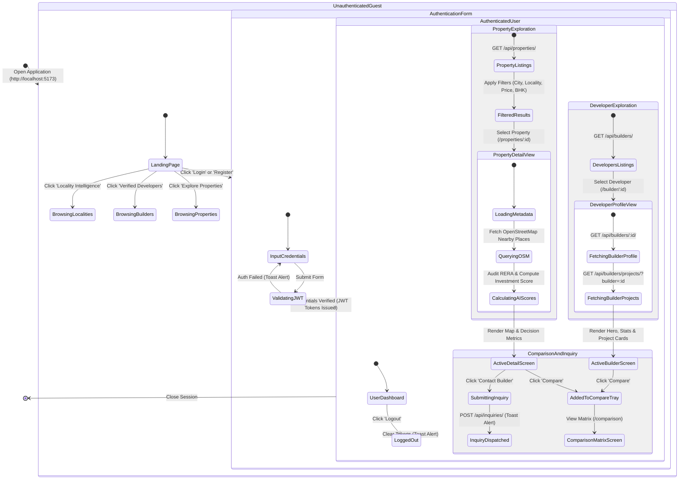
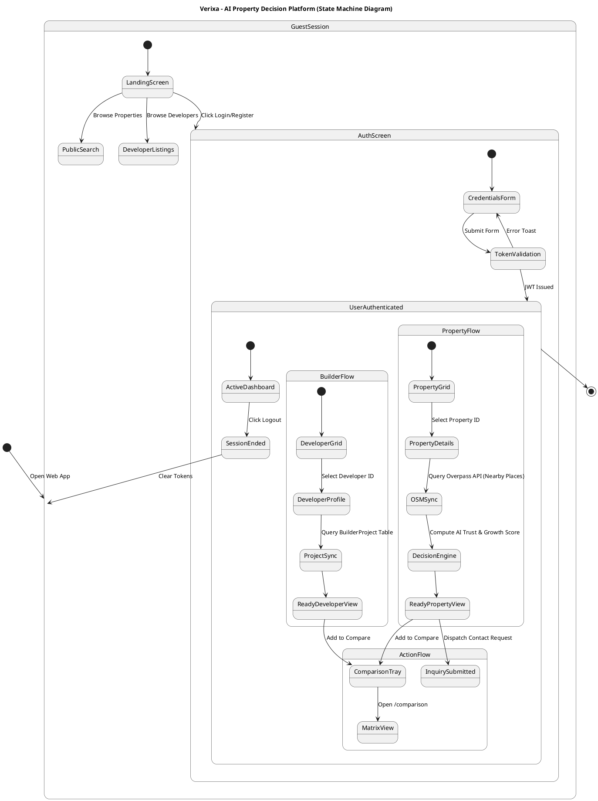

# Verixa - System State Diagram (UML State Machine)

This document contains the complete **UML State Machine Diagram** for **Verixa (AI Property Decision Platform)**.

---

## 1. Mermaid.js Code (Recommended)

---

## 2. PlantUML Code (Alternative Format)

